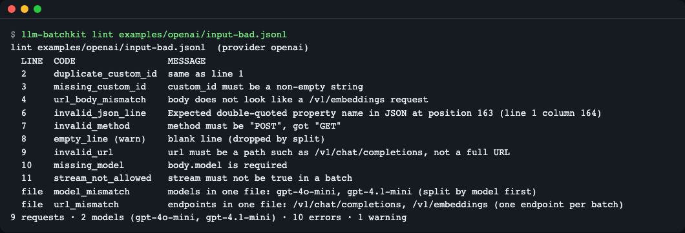
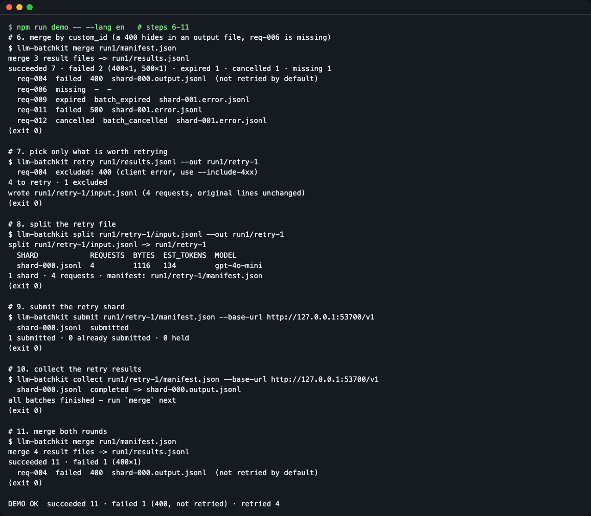
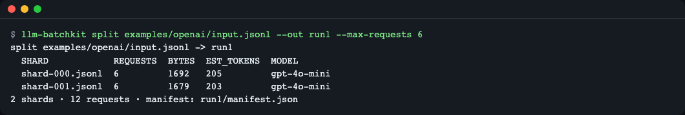
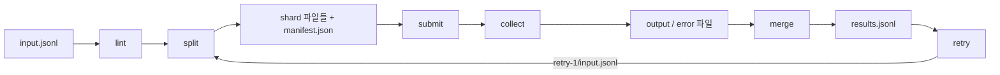

# llm-batchkit

[English](README.md) | **한국어**

Batch 작업은 파일 하나를 올리고 최대 24시간 뒤에 결과를 받는 방식이라, 입력 파일의 실수를 늦게 알게 되고 결과도 여러 파일에 흩어져 돌아옵니다. `llm-batchkit` 은 그 앞뒤의 파일 작업(검사 → 분할 → 병합 → 재시도 파일 만들기)을 줄 번호와 요청 ID 단위로 해 주는 CLI 입니다.


*일부러 망가뜨린 입력 파일을 업로드 전에 검사한 화면. 줄 번호와 오류 코드가 한 줄씩 나옵니다.*

## 이런 분께
- 수만 건짜리 JSONL 을 올렸다가 "중복 `custom_id`" 같은 오류 한 줄 때문에 전체가 거부된 적이 있는 분
- 한 파일이 요청 수·용량 한도를 넘어 직접 쪼개고 있는 분
- 결과가 output 파일과 error 파일로 나뉘고 순서도 섞여 와서, 어떤 요청이 실패했는지 찾기 번거로운 분

## 설치
아직 npm 에 게시하지 않았습니다. 저장소를 받아 빌드해서 씁니다. Node.js 22.12 이상이 필요합니다.
```bash
# Node.js 가 없다면(macOS): brew install node
git clone https://github.com/LeeGyeongPil/llm-batchkit
cd llm-batchkit
npm install          # 설치 후 자동으로 빌드(dist/)까지 합니다
node dist/cli.js --help
```
이 문서의 `llm-batchkit ...` 는 `node dist/cli.js ...` 와 같습니다. 짧게 쓰려면 `npm link` 로 `llm-batchkit` 명령을 등록하세요. 최소 리눅스 환경에는 `git` 과 `nodejs`(22.12 이상), `npm` 이 필요합니다. 런타임 의존성은 없습니다.

## 빠르게 시작하기
API 키 없이, 저장소에 들어 있는 연습용 mock(모의) 서버로 전체 과정을 한 번에 돌려 봅니다.
```bash
npm run demo
```
마지막 줄이 다음과 같으면 성공입니다.
```
DEMO OK  succeeded 11 · failed 1 (400, not retried) · retried 4
```
첫 줄에 `PRACTICE MOCK MODE` 가 찍힙니다. 이는 127.0.0.1 에서만 도는 **연습용 목(mock) 모드**로, 실제 서버의 시간·한도·가격·오류 문구는 재현하지 않습니다.


*병합 결과(성공 7, 실패 2, 만료 1, 취소 1, 누락 1) → 재시도 4건 → 다시 병합(성공 11, 400 한 건만 남음).*

## 사용법
| 명령 | 하는 일 | 예 |
|---|---|---|
| `lint <file>` | 줄 번호가 붙은 입력 검사. 오류가 있으면 종료 코드 1 | `lint input.jsonl --provider openai --json` |
| `split <file> --out <dir> [--force]` | 모델·엔드포인트별로 묶고 요청 수·바이트·추정 토큰 한도에 맞춰 샤드(조각 파일)로 나눔. `manifest.json` 기록 | `split input.jsonl --out run1 --max-requests 5000` |
| `submit <manifest>` | 샤드를 업로드하고 배치 생성. 이미 올린 샤드는 건너뜀(이어 돌리기). 상태가 `failed` 인 샤드만 다시 제출하고, 진행 중·완료된 배치는 다시 보내지 않음(완료 배치는 `--resubmit-changed` 로만) | `submit run1/manifest.json --max-enqueued-tokens 2000000` |
| `collect <manifest>` | 끝난 배치의 output·error 파일 내려받기. `--wait` 로 기다림 | `collect run1/manifest.json --wait --interval 60` |
| `merge <manifest> [files...]` | 결과를 `custom_id` 기준 입력 순서로 모음. `results.jsonl`(·`--csv`) 작성 | `merge run1/manifest.json --csv results.csv` |
| `retry <results.jsonl> --out <dir>` | 재시도할 요청만 원본 줄 그대로 새 파일로 작성 | `retry run1/results.jsonl --out run1/retry-1` |
| `mock-server` | 연습용 mock Batch API 를 로컬에 띄움 | `mock-server --port 8787 --scenario examples/mock-scenario.json` |

공통 옵션: `--provider auto|openai|azure|anthropic`(기본 자동 판별), `--max-requests`, `--max-bytes`(예: `200MiB`), `--max-tokens`.

### 시나리오 1. 올리기 전에 검사하기
```bash
node dist/cli.js lint examples/openai/input-bad.jsonl
```
```
lint examples/openai/input-bad.jsonl  (provider openai)
  LINE  CODE                 MESSAGE
  2     duplicate_custom_id  same as line 1
  3     missing_custom_id    custom_id must be a non-empty string
  4     url_body_mismatch    body does not look like a /v1/embeddings request
  6     invalid_json_line    Expected double-quoted property name in JSON at position 163 (line 1 column 164)
  7     invalid_method       method must be "POST", got "GET"
  8     empty_line (warn)    blank line (dropped by split)
  9     invalid_url          url must be a path such as /v1/chat/completions, not a full URL
  10    missing_model        body.model is required
  11    stream_not_allowed   stream must not be true in a batch
  file  model_mismatch       models in one file: gpt-4o-mini, gpt-4.1-mini (split by model first)
  file  url_mismatch         endpoints in one file: /v1/chat/completions, /v1/embeddings (one endpoint per batch)
9 requests · 2 models (gpt-4o-mini, gpt-4.1-mini) · 10 errors · 1 warning
```
같은 코드의 이슈가 50개를 넘으면 나머지는 `... and N more <code> (use --json to list all)` 로 접고, `--json` 에는 전부 담습니다. 빈 파일은 `empty_file` 오류(종료 코드 1)입니다.

읽는 법: `LINE` 은 입력 파일의 줄 번호, `file` 은 파일 전체에 해당하는 문제입니다. `(warn)` 은 경고라 종료 코드에 영향이 없고(`--strict` 를 주면 실패 처리), 나머지는 오류라 종료 코드가 1 입니다. Anthropic 파일은 `custom_id` 형식(`^[a-zA-Z0-9_-]{1,64}$`)과 `max_tokens`, 금지 파라미터도 검사합니다(`examples/anthropic/requests.json`).

### 시나리오 2. 한도에 맞춰 나누기
```bash
node dist/cli.js split examples/openai/input.jsonl --out run1 --max-requests 6
```
```
split examples/openai/input.jsonl -> run1
  SHARD            REQUESTS  BYTES  EST_TOKENS  MODEL
  shard-000.jsonl  6         1692   205         gpt-4o-mini
  shard-001.jsonl  6         1679   203         gpt-4o-mini
2 shards · 12 requests · manifest: run1/manifest.json
```

*12건을 6건씩 샤드 2개로 나눈 화면. `manifest.json` 에 원래 순서와 샤드 대응이 기록됩니다.*

읽는 법: `EST_TOKENS` 는 글자 수 ÷ 4 로 어림한 값입니다. `split` 은 줄 단위 오류가 있는 파일을 거부하므로 먼저 `lint` 를 통과시키세요.

### 시나리오 3. 제출·수집·병합·재시도 (mock 으로 연습)
터미널 하나에서 mock 서버를, 다른 터미널에서 나머지를 실행합니다.
```bash
node dist/cli.js mock-server --port 8787
```
```bash
node dist/cli.js submit run1/manifest.json --base-url http://127.0.0.1:8787/v1
node dist/cli.js collect run1/manifest.json --base-url http://127.0.0.1:8787/v1
node dist/cli.js merge run1/manifest.json
node dist/cli.js retry run1/results.jsonl --out run1/retry-1
```
`npm run demo` 가 같은 순서를 한 번에 보여 주며, 그 출력은 다음과 같습니다(경로는 줄였습니다).
```
$ llm-batchkit merge run1/manifest.json
succeeded 7 · failed 2 (400×1, 500×1) · expired 1 · cancelled 1 · missing 1
  req-004  failed  400  shard-000.output.jsonl  (not retried by default)
  req-006  missing  -  -
  req-009  expired  batch_expired  shard-001.error.jsonl
  req-011  failed  500  shard-001.error.jsonl
  req-012  cancelled  batch_cancelled  shard-001.error.jsonl

$ llm-batchkit retry run1/results.jsonl --out run1/retry-1
  req-004  excluded: 400 (client error, use --include-4xx)
4 to retry · 1 excluded
wrote run1/retry-1/input.jsonl (4 requests, original lines unchanged)
```
읽는 법: `req-004` 는 400 응답이 **output 파일**에 들어 있었고, `req-011` 은 500 이 **error 파일**에 있었습니다. 파일 종류가 아니라 줄 내용으로 분류하기 때문에 둘 다 실패로 잡힙니다. 400 같은 요청 자체의 오류는 다시 보내도 같은 결과라서 기본으로 제외합니다.

재시도 결과를 합치려면 재시도 폴더에서 한 번 더 `split` → `submit` → `collect` 한 뒤 처음 manifest 로 `merge` 합니다. 자동 발견은 `--out` 이 정확히 `<run>/retry-N` 일 때만 동작합니다(N회차로 합침).
```bash
node dist/cli.js split run1/retry-1/input.jsonl --out run1/retry-1
node dist/cli.js submit run1/retry-1/manifest.json --base-url http://127.0.0.1:8787/v1
node dist/cli.js collect run1/retry-1/manifest.json --base-url http://127.0.0.1:8787/v1
node dist/cli.js merge run1/manifest.json
```
```
  shard-000.jsonl  submitted
1 submitted · 0 already submitted · 0 held
  shard-000.jsonl  completed -> shard-000.output.jsonl
all batches finished - run `merge` next
merge 4 result files -> run1/results.jsonl
succeeded 11 · failed 1 (400×1)
  req-004  failed  400  shard-000.output.jsonl  (not retried by default)
```
여기서 `retry` 를 다시 실행하면 `nothing to retry (1 excluded)` 가 나옵니다. 성공한 행은 다시 고르지 않습니다. 성공한 결과는 항상 실패보다 우선하고, 성공이 여러 번이면 첫 성공을 남기며 중복으로 보고합니다. Anthropic 결과는 공식 방법으로 받은 파일을 `*.results.jsonl` 이름으로 manifest 옆에 두거나 `merge <manifest> <파일...>` 인자로 넘기세요.

### 실패한 배치 고치기
제공자가 입력 검증으로 배치를 거부하면 `collect` 가 종료 코드 1 과 줄 번호가 붙은 오류를 냅니다. 해당 샤드 파일(`run1/shard-000.jsonl`)을 고친 뒤 `submit` 을 다시 실행하세요. `submit` 은 파일 내용보다 **배치 상태를 먼저** 봅니다.

| 샤드의 배치 상태 | `submit` 의 동작 |
|---|---|
| `failed` (입력 검증 거절·일시 오류) | 고쳤든 아니든 다시 올림. 이전 배치 ID 는 `batches.json` 의 `history` 에 남음 |
| 진행 중 | 절대 다시 올리지 않음. 샤드 파일이 바뀌었으면 업로드 0 으로 종료 코드 1 |
| 완료 | 건너뜀. 샤드 파일이나 `manifest.json` 이 바뀌었으면 업로드 0 으로 종료 코드 1 (결과가 이미 있고 다시 보내면 과금이 또 됩니다) |
| 완료 + 바뀐 샤드를 일부러 다시 보내기 | `--resubmit-changed` 를 줄 때만 다시 올림 |

옛 결과 파일은 지우지 않고 `shard-000.output.replaced-<batch_id>.jsonl` 로 이름을 바꿔 보관하며, `merge` 는 이 파일을 쓰지 않습니다. 실제로 mock 서버에서 완료된 `shard-000.jsonl` 끝에 빈 줄을 붙인 뒤 실행한 결과입니다.
```
$ llm-batchkit submit run1/manifest.json --base-url http://127.0.0.1:<port>/v1
error: refusing to submit - nothing was uploaded:
  shard-000.jsonl changed after batch_mock_1 completed
  fix: Its results are already there. Restore the shard file, or split the edited input into a new folder. To send it again on purpose (the requests are billed again) pass --resubmit-changed.

$ llm-batchkit submit run1/manifest.json --base-url http://127.0.0.1:<port>/v1 --resubmit-changed
  shard-000.jsonl  submitted (replaces an earlier batch: changed after completed batch_mock_1)
  shard-001.jsonl  already submitted (skipped)
kept old result files as shard-000.output.replaced-batch_mock_1.jsonl (merge ignores them)
1 submitted · 1 already submitted · 0 held
```
첫 명령은 종료 코드 1, 둘째는 0 입니다. 이미 결과가 있는 폴더에 `split` 하면 `out_dir_in_use` 로 거부하고, `--force` 는 배치가 전부 `failed` 인 폴더에서만 샤드 파일을 덮어씁니다. 진행 중이거나 완료된 배치가 있으면 `--force` 도 `out_dir_has_batches` 로 거부하므로 새 폴더(`--out run2`)에 나누세요.

### 재시도 규칙
| 상태 | 기본 동작 |
|---|---|
| 만료(expired)·취소(cancelled)·누락(missing) | 재시도 |
| 429, 5xx, Anthropic `api_error`·`overloaded_error`·`rate_limit_error` | 재시도 |
| 그 밖의 4xx·error 객체 | 제외 (`--include-4xx` 로 포함) |
| `custom_id` 는 있으나 응답 형식을 알 수 없음(`indeterminate`) | 제외(이미 과금됐을 수 있음) |

`--only expired,cancelled,missing,failed` 로 종류를 좁힐 수 있습니다.

## 설정
- 환경변수는 실제 `submit`/`collect` 에만 필요합니다. [.env.example](.env.example) 참고.
  - `OPENAI_API_KEY`: OpenAI 호환 엔드포인트용 키
  - `OPENAI_BASE_URL`: 선택. 기본 `https://api.openai.com/v1` (`--base-url` 로도 지정)
- `lint`·`split`·`merge`·`retry`·`npm run demo` 는 키도 네트워크도 필요 없습니다.
- 제공자별 기본 한도(2026-11-11 문서 기준, `src/providers.ts` 주석에 출처). 한도는 바뀌므로 `--max-*` 로 덮어쓸 수 있습니다.

| 제공자 | 요청 수 | 파일 크기 | 비고 |
|---|---|---|---|
| openai | 50,000 | 200 MiB(209,715,200 바이트) | 한 파일 한 모델·한 엔드포인트, 임베딩 입력 50,000 |
| azure | 100,000 | 200 MiB | 모델 자리에 배포 이름 |
| anthropic | 100,000 | 256,000,000 바이트 | `custom_id` 패턴, `max_tokens` 필수, `stream` 금지 |

- 종료 코드: `lint` 오류 1 / 사용법 오류 64 / 해결 방법이 붙은 런타임 오류 1(`submit` 이 완료·진행 중 배치의 샤드 변경을 거부한 경우 포함, 업로드 0) / `collect` 0(모두 완료)·1(검증 실패 배치, 또는 제출된 샤드가 하나도 없는 폴더)·2(일부가 진행 중이거나 보류).
- **실제 API 모드**: 유료이며 결과까지 최대 24시간이 걸릴 수 있습니다. 이 저장소의 테스트와 CI 는 mock 으로만 검증했고, **실제 API 경로는 직접 확인이 필요합니다**(작은 파일로 먼저 시험하세요).

## 동작 원리

1. `lint`: 줄마다 JSON·`custom_id`·메서드·URL·모델을 확인하고 파일 전체의 모델·엔드포인트 혼합을 찾습니다.
2. `split`: 모델과 엔드포인트로 묶은 뒤 요청 수·바이트·추정 토큰 한도로 샤드를 만들고, 순서를 `manifest.json` 에 적습니다.
3. `submit`/`collect`: 샤드마다 파일 ID·배치 ID 를 `batches.json` 에 바로 기록해서, 중간에 멈춰도 같은 샤드를 다시 올리지 않습니다. `--max-enqueued-tokens` 를 넘기면 그 샤드부터 보류합니다.
4. `merge`: output·error 파일의 모든 줄을 내용으로 분류해 `custom_id` 로 합치고 입력 순서로 되돌립니다. 중복·모르는 ID·누락을 따로 보고합니다.
5. `retry`: 재시도 대상만 원본 줄 그대로 새 입력 파일로 씁니다. 그 파일을 다시 `split` 부터 돌립니다.

## 파일 형식
`split` 이 만드는 폴더(예: `run1/`)에는 다음이 생깁니다.

| 파일 | 만든 명령 | 역할 |
|---|---|---|
| `shard-NNN.jsonl` | split | 제공자에 올리는 조각 파일. 원본 줄 그대로 |
| `manifest.json` | split | 입력 순서와 샤드 대응. 시간 값이 없어 같은 입력이면 같은 내용 |
| `batches.json` | submit | 샤드별 업로드·배치 기록. 지우면 다음 `submit` 이 전부 다시 올립니다 |
| `shard-NNN.output.jsonl`·`.error.jsonl` | collect | 제공자가 돌려준 결과 파일 |
| `shard-NNN.output.replaced-<batch_id>.jsonl` | submit | 다시 올리면서 보관한 옛 결과. `merge` 가 무시 |
| `results.jsonl` | merge | 요청 한 건당 한 줄의 최종 결과 |
| `retry-N/input.jsonl` | retry | 재시도할 요청만 모은 입력 |

`manifest.json` 주요 필드: `provider`, `source`·`source_sha256`(원본 입력), `limits`(적용한 한도), `order`(`custom_id` 의 입력 순서), `shards[]`(`file`, `url`, `model`, `count`, `bytes`, `est_tokens`, `custom_ids`).

`batches.json` 주요 필드: `base_url`, `held`(대기열 예산 때문에 보류한 샤드), `shards.<샤드>` 의 `input_file_id`, `batch_id`, `status`, `output_file_id`, `error_file_id`, `downloaded`, `input_sha256`, `history`(교체된 이전 배치, 보관한 옛 결과 파일 이름).

`results.jsonl` 한 줄 예(보기 좋게 줄였습니다).
```json
{"custom_id":"req-001","status":"succeeded","code":200,"retryable":false,"source":"shard-000.output.jsonl","round":0,"reason":null,"text":"[mock] The library opens ...","response":{"status_code":200,"body":{}}}
```
| 필드 | 뜻 |
|---|---|
| `custom_id` | 요청 ID |
| `status` | `succeeded`·`failed`·`expired`·`cancelled`·`missing` |
| `code` | HTTP 상태 코드 또는 `batch_expired` 같은 코드(없으면 `null`) |
| `retryable` | 기본 규칙으로 재시도 대상인지 |
| `source`·`round` | 채택한 줄이 온 파일과 회차(0 = 첫 제출, N = `retry-N`) |
| `reason` | 실패 사유(없으면 `null`) |
| `text`·`response` | 성공일 때만. 응답 본문과 그 안의 텍스트 |

## 연습용 목 서버
`mock-server` 는 키 없이 전체 과정을 시험하게 해 주는 **연습용** 서버로 127.0.0.1 에만 바인딩합니다. 업로드 본문을 실제로 `lint` 해서 오류가 있으면 배치를 `failed` 로 만듭니다. `--port 0` 은 빈 포트를 고르고, 잘못된 값은 종료 코드 64, 이미 쓰는 포트는 해결 방법이 붙은 오류로 끝납니다.

`--scenario` 파일은 `custom_id` 마다 회차별 결과 목록을 줍니다. 첫 값이 첫 제출, 둘째가 `retry-1` 의 결과입니다. 회차 상태는 서버가 켜져 있는 동안 유지됩니다. 같은 서버로 시나리오를 두 번 돌리면 결과가 달라지므로 README 와 같은 결과를 보려면 서버를 새로 띄워 한 번만 돌리세요(포트가 사용 중이면 `--port 0`).
```json
{ "results": { "req-004": ["400"], "req-006": ["drop", "ok"], "req-011": ["500", "ok"] } }
```
결과 종류: `ok`·`400`(output 파일에 담김)·`429`·`500`(error 파일에 담김)·`expired`·`cancelled`·`drop`(결과에서 빠짐). 목이 재현하지 않는 것: 실제 처리 시간, 한도, 가격, 제공자의 오류 문구. 전체 예는 `examples/mock-scenario.json`.

## 라이브러리로 쓰기
```ts
import { lintFile, splitFile, mergeResults, selectRetries } from 'llm-batchkit';
```
CLI 와 같은 기능을 함수로 호출할 수 있습니다(`dist/index.js`). 시그니처는 `src/index.ts` 가 내보내는 타입을 보세요. 예를 들어 `mergeResults(manifestPath)` 는 `{ rows, summary, ... }` 를 돌려주고, `selectRetries` 는 그 행들에서 재시도 대상을 고릅니다.

npm 에 게시되지 않았으므로 다른 프로젝트에서는 로컬 경로로 설치합니다(먼저 이 저장소에서 `npm ci && npm run build`).
```bash
npm install /path/to/llm-batchkit
```

## 한계
- 토큰 수는 글자 수 ÷ 4 로 어림한 값입니다. 정확한 토크나이저가 아니므로 `--max-tokens` 에 여유를 두세요.
- 파일을 통째로 메모리에 읽습니다(한도인 200 MiB 까지는 문제없지만 스트리밍은 아닙니다).
- `submit`/`collect` 는 OpenAI 호환 엔드포인트만 지원합니다. Azure·Anthropic 제출은 아직 없고(명확한 오류가 납니다), 두 제공자는 `lint`·`split`·`merge`·`retry` 만 쓸 수 있습니다.
- mock 서버는 실제 시간·한도·가격·오류 문구를 재현하지 않으며, 실제 API 와의 동작은 검증하지 않았습니다.
- 테스트 파일은 빌드(`tsc`)의 타입 검사 대상이 아닙니다.
- 중복 제출 방지는 폴더(`batches.json`) 단위입니다. 같은 요청을 다른 폴더에서 다시 `submit` 하면 다시 과금되니, 새 폴더에는 바뀐 요청만 넣으세요.
- HTTP 요청별 타임아웃이 없어 응답하지 않는 서버에서는 Ctrl+C 로 끊어야 합니다.
- 알려진 표시 문제: `submit` 출력은 샤드를 manifest 순서가 아니라 새로 올린 것 먼저, 이미 제출된 것 나중 순서로 찍습니다. 오류 메시지에는 `out_dir_in_use`·`shard_exceeds_budget` 같은 코드명이 찍히지 않으니 이 문서의 코드명은 메시지 문구로 찾으세요. `npm run demo` 는 경로를 절대 경로로 출력합니다(환경마다 다름).
- npm 에 게시되지 않았습니다.

## 언제 쓰나
- 이럴 때: 이미 만든 JSONL 을 업로드 전에 오프라인으로 점검·분할하고, 돌아온 결과 파일을 요청 단위로 정리하고 싶을 때.
- 이럴 땐 다른 도구: 코드에서 여러 제공자로 배치를 제출·관리하는 라이브러리가 필요하면 [batch-ai](https://github.com/grantsingleton/batch-ai), 단순히 직접 호출하려면 공식 SDK([openai-node](https://github.com/openai/openai-node), [anthropic-sdk-typescript](https://github.com/anthropics/anthropic-sdk-typescript)).

## 자주 겪는 문제
| 증상 | 원인 | 해결 |
|---|---|---|
| `split` 이 "N line-level error(s)" 로 거부 | 입력에 줄 단위 오류가 있음 | 먼저 `lint` 로 줄 번호를 보고 고친 뒤 다시 실행 |
| `merge` 가 "No *.output.jsonl / *.error.jsonl files" 오류 | 아직 `collect` 를 하지 않음 | `collect` 를 먼저 실행하거나 결과 파일을 인자로 직접 전달 |
| `collect` 종료 코드 2 | 일부 배치가 아직 진행 중이거나 보류 | `--wait` 로 기다리거나 나중에 다시 실행 |
| `collect` 가 `batches.json has no submitted shards` 로 종료 코드 1 | 아직 `submit` 하지 않은 폴더 | 먼저 `submit` 을 실행 |
| `shard_exceeds_budget` | 샤드 하나가 `--max-enqueued-tokens` 보다 큼 | `split --max-tokens` 를 낮춰 샤드를 더 작게 만들기 |
| `submit` 에서 키 오류 | `OPENAI_API_KEY` 가 없음 | 환경변수를 설정하거나 로컬 `--base-url`(mock) 사용 |
| `retry` 가 "nothing to retry" | 재시도할 만한 행이 없음(남은 4xx 는 제외됨) | 요청을 고친 뒤 `--include-4xx` 로 포함 |

## 개발·기여
```bash
npm test        # 빌드 후 vitest (8 파일, 76 테스트)
npm run demo    # 키 없이 전체 과정 연습
```
버그·제안은 이슈로 남겨 주세요. 변경 기록은 [CHANGELOG.md](CHANGELOG.md).

## 더 알아보기 (확인 2026-11-11)
- [OpenAI Batch 가이드](https://developers.openai.com/api/docs/guides/batch.md) — 입력·출력·오류 형식과 한도
- [Anthropic Message Batches](https://platform.claude.com/docs/en/build-with-claude/batch-processing) — 한도, 만료, 금지 파라미터
- [Azure OpenAI Batch](https://learn.microsoft.com/en-us/azure/foundry/openai/how-to/batch) · [Azure 할당량과 한도](https://learn.microsoft.com/azure/foundry/openai/quotas-limits)
- [OpenAI 커뮤니티: enqueued token limit](https://community.openai.com/t/no-batches-in-progress-but-get-enqueued-token-limit-reached/1033872) — 대기열 토큰 한도 사례

## 라이선스
MIT. 외부 모델·데이터는 포함하지 않습니다.
