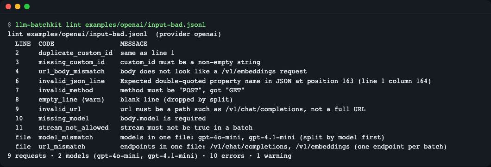
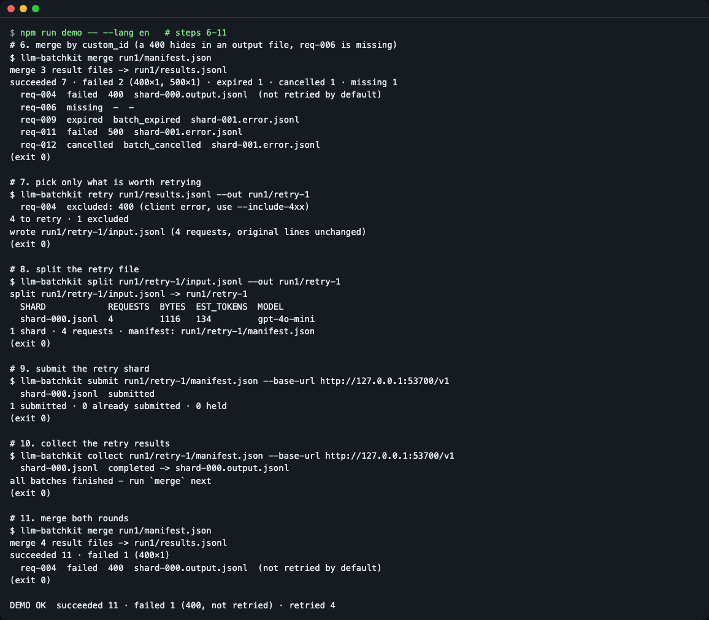
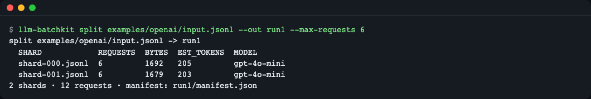
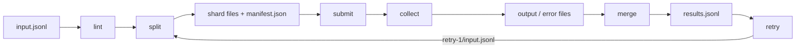

# llm-batchkit

**English** | [한국어](README.ko.md)

A command-line toolkit for LLM Batch API files: lint a JSONL input before uploading, split it to fit request/byte/token limits, merge the scattered output and error files back by `custom_id`, and write a retry file with only the requests worth retrying. A batch job returns results up to 24 hours later, so input mistakes are found late and results come back scattered; this CLI does the file work before and after, by line number and request ID. It is for anyone running large OpenAI, Azure OpenAI or Anthropic batch jobs. Install: `git clone` + `npm install` (not published to npm yet); try it without any API key via `npm run demo`.


*Screen from linting a deliberately broken input file before upload. The line number and error code appear one per line.*

## Who it is for
- People who uploaded a JSONL with tens of thousands of entries and had the whole thing rejected because of a single line such as a duplicate `custom_id`
- People whose file exceeds the request-count or size limit and who are splitting it by hand
- People for whom results come back split into an output file and an error file in mixed order, making it a hassle to find which requests failed

## Installation
It is not published to npm yet. Download the repository and build it. Node.js 22.12 or later is required.
```bash
# If you do not have Node.js (macOS): brew install node
git clone https://github.com/LeeGyeongPil/llm-batchkit
cd llm-batchkit
npm install          # also builds dist/ automatically after install
node dist/cli.js --help
```
(Comments: "If you do not have Node.js (macOS): brew install node" and "after installation it also builds (dist/) automatically".)

`llm-batchkit ...` in this document is the same as `node dist/cli.js ...`. To keep it short, register the `llm-batchkit` command with `npm link`. A minimal Linux environment needs `git`, `nodejs` (22.12 or later) and `npm`. There are no runtime dependencies.

## Quick start
Run the whole process in one go, with no API key, against the practice mock server included in the repository.
```bash
npm run demo
```
If the last line is as follows, it succeeded.
```
DEMO OK  succeeded 11 · failed 1 (400, not retried) · retried 4
```
`PRACTICE MOCK MODE` is printed on the first line. This is a **practice mock mode** that runs only on 127.0.0.1 and does not reproduce a real server's timing, limits, prices or error wording.


*Merge result (7 succeeded, 2 failed, 1 expired, 1 cancelled, 1 missing) → 4 retries → merged again (11 succeeded, only the one 400 remains).*

## Usage
| Command | What it does | Example |
|---|---|---|
| `lint <file>` | Checks the input with line numbers attached. Exit code 1 if there are errors | `lint input.jsonl --provider openai --json` |
| `split <file> --out <dir> [--force]` | Groups by model and endpoint and divides into shards (piece files) to fit the request-count, byte and estimated-token limits. Records `manifest.json` | `split input.jsonl --out run1 --max-requests 5000` |
| `submit <manifest>` | Uploads the shards and creates batches. Skips shards already uploaded (resumable). Resubmits only shards whose status is `failed`, and does not resend in-progress or completed batches (completed ones only with `--resubmit-changed`) | `submit run1/manifest.json --max-enqueued-tokens 2000000` |
| `collect <manifest>` | Downloads the output and error files of finished batches. `--wait` waits for them | `collect run1/manifest.json --wait --interval 60` |
| `merge <manifest> [files...]` | Gathers results in input order by `custom_id`. Writes `results.jsonl` (and `--csv`) | `merge run1/manifest.json --csv results.csv` |
| `retry <results.jsonl> --out <dir>` | Writes only the requests to retry into a new file, with the original lines unchanged | `retry run1/results.jsonl --out run1/retry-1` |
| `mock-server` | Starts a practice mock Batch API locally | `mock-server --port 8787 --scenario examples/mock-scenario.json` |

Common options: `--provider auto|openai|azure|anthropic` (default auto-detect), `--max-requests`, `--max-bytes` (for example `200MiB`), `--max-tokens`.

### Scenario 1. Check before uploading
```bash
node dist/cli.js lint examples/openai/input-bad.jsonl
```
```
lint examples/openai/input-bad.jsonl  (provider openai)
  LINE  CODE                 MESSAGE
  2     duplicate_custom_id  same as line 1
  3     missing_custom_id    custom_id must be a non-empty string
  4     url_body_mismatch    body does not look like a /v1/embeddings request
  6     invalid_json_line    Expected double-quoted property name in JSON at position 163 (line 1 column 164)
  7     invalid_method       method must be "POST", got "GET"
  8     empty_line (warn)    blank line (dropped by split)
  9     invalid_url          url must be a path such as /v1/chat/completions, not a full URL
  10    missing_model        body.model is required
  11    stream_not_allowed   stream must not be true in a batch
  file  model_mismatch       models in one file: gpt-4o-mini, gpt-4.1-mini (split by model first)
  file  url_mismatch         endpoints in one file: /v1/chat/completions, /v1/embeddings (one endpoint per batch)
9 requests · 2 models (gpt-4o-mini, gpt-4.1-mini) · 10 errors · 1 warning
```
If issues of the same code exceed 50, the rest are folded into `... and N more <code> (use --json to list all)`, and `--json` contains all of them. An empty file is an `empty_file` error (exit code 1).

How to read it: `LINE` is the line number in the input file, and `file` is a problem that applies to the whole file. `(warn)` is a warning with no effect on the exit code (it counts as a failure if you pass `--strict`), and everything else is an error, so the exit code is 1. For Anthropic files, the `custom_id` format (`^[a-zA-Z0-9_-]{1,64}$`), `max_tokens` and forbidden parameters are also checked (`examples/anthropic/requests.json`).

### Scenario 2. Split to fit the limits
```bash
node dist/cli.js split examples/openai/input.jsonl --out run1 --max-requests 6
```
```
split examples/openai/input.jsonl -> run1
  SHARD            REQUESTS  BYTES  EST_TOKENS  MODEL
  shard-000.jsonl  6         1692   205         gpt-4o-mini
  shard-001.jsonl  6         1679   203         gpt-4o-mini
2 shards · 12 requests · manifest: run1/manifest.json
```

*Screen showing 12 requests split into 2 shards of 6. The original order and the shard mapping are recorded in `manifest.json`.*

How to read it: `EST_TOKENS` is an estimate of character count ÷ 4. `split` rejects files that have line-level errors, so pass `lint` first.

### Scenario 3. Submit, collect, merge, retry (practice with the mock)
Run the mock server in one terminal and the rest in another.
```bash
node dist/cli.js mock-server --port 8787
```
```bash
node dist/cli.js submit run1/manifest.json --base-url http://127.0.0.1:8787/v1
node dist/cli.js collect run1/manifest.json --base-url http://127.0.0.1:8787/v1
node dist/cli.js merge run1/manifest.json
node dist/cli.js retry run1/results.jsonl --out run1/retry-1
```
`npm run demo` shows the same order in one go, and its output is as follows (paths shortened).
```
$ llm-batchkit merge run1/manifest.json
succeeded 7 · failed 2 (400×1, 500×1) · expired 1 · cancelled 1 · missing 1
  req-004  failed  400  shard-000.output.jsonl  (not retried by default)
  req-006  missing  -  -
  req-009  expired  batch_expired  shard-001.error.jsonl
  req-011  failed  500  shard-001.error.jsonl
  req-012  cancelled  batch_cancelled  shard-001.error.jsonl

$ llm-batchkit retry run1/results.jsonl --out run1/retry-1
  req-004  excluded: 400 (client error, use --include-4xx)
4 to retry · 1 excluded
wrote run1/retry-1/input.jsonl (4 requests, original lines unchanged)
```
How to read it: for `req-004` the 400 response was in the **output file**, and for `req-011` the 500 was in the **error file**. Because classification goes by line content rather than file type, both are caught as failures. Errors in the request itself, like 400, give the same result when resent, so they are excluded by default.

To merge the retry results, run `split` → `submit` → `collect` once more in the retry folder and then `merge` with the first manifest. Auto-discovery works only when `--out` is exactly `<run>/retry-N` (merged as round N).
```bash
node dist/cli.js split run1/retry-1/input.jsonl --out run1/retry-1
node dist/cli.js submit run1/retry-1/manifest.json --base-url http://127.0.0.1:8787/v1
node dist/cli.js collect run1/retry-1/manifest.json --base-url http://127.0.0.1:8787/v1
node dist/cli.js merge run1/manifest.json
```
```
  shard-000.jsonl  submitted
1 submitted · 0 already submitted · 0 held
  shard-000.jsonl  completed -> shard-000.output.jsonl
all batches finished - run `merge` next
merge 4 result files -> run1/results.jsonl
succeeded 11 · failed 1 (400×1)
  req-004  failed  400  shard-000.output.jsonl  (not retried by default)
```
If you run `retry` again here, you get `nothing to retry (1 excluded)`. Successful rows are not picked again. A success always takes priority over a failure, and if there are several successes, the first is kept and the rest are reported as duplicates. For Anthropic results, put the file obtained by the official method next to the manifest under the name `*.results.jsonl`, or pass it as an argument of `merge <manifest> <files...>`.

### Fixing a failed batch
If the provider rejects a batch during input validation, `collect` gives exit code 1 and an error with a line number. Fix the shard file (`run1/shard-000.jsonl`) and run `submit` again. `submit` looks at the **batch state first**, before the file contents.

| Batch state of the shard | What `submit` does |
|---|---|
| `failed` (input validation rejection, transient error) | Uploads again whether or not you fixed it. The previous batch ID stays in `history` of `batches.json` |
| In progress | Never uploads again. If the shard file changed, it exits with upload 0 and exit code 1 |
| Completed | Skipped. If the shard file or `manifest.json` changed, it exits with upload 0 and exit code 1 (the results already exist, and sending again is billed again) |
| Completed + deliberately resending a changed shard | Uploads again only when you pass `--resubmit-changed` |

Old result files are not deleted but renamed to `shard-000.output.replaced-<batch_id>.jsonl` and kept, and `merge` does not use them. This is the actual result of appending a blank line to the end of the completed `shard-000.jsonl` on the mock server and then running.
```
$ llm-batchkit submit run1/manifest.json --base-url http://127.0.0.1:<port>/v1
error: refusing to submit - nothing was uploaded:
  shard-000.jsonl changed after batch_mock_1 completed
  fix: Its results are already there. Restore the shard file, or split the edited input into a new folder. To send it again on purpose (the requests are billed again) pass --resubmit-changed.

$ llm-batchkit submit run1/manifest.json --base-url http://127.0.0.1:<port>/v1 --resubmit-changed
  shard-000.jsonl  submitted (replaces an earlier batch: changed after completed batch_mock_1)
  shard-001.jsonl  already submitted (skipped)
kept old result files as shard-000.output.replaced-batch_mock_1.jsonl (merge ignores them)
1 submitted · 1 already submitted · 0 held
```
The first command has exit code 1, the second 0. Running `split` into a folder that already has results is refused with `out_dir_in_use`, and `--force` overwrites shard files only in a folder where all batches are `failed`. If there are in-progress or completed batches, `--force` is also refused with `out_dir_has_batches`, so split into a new folder (`--out run2`).

### Retry rules
| State | Default behavior |
|---|---|
| Expired, cancelled, missing | Retry |
| 429, 5xx, Anthropic `api_error`, `overloaded_error`, `rate_limit_error` | Retry |
| Any other 4xx or error object | Excluded (include with `--include-4xx`) |
| Has a `custom_id` but the response format is unknown (`indeterminate`) | Excluded (it may already have been billed) |

You can narrow the kinds with `--only expired,cancelled,missing,failed`.

## Configuration
- Environment variables are needed only for the real `submit`/`collect`. See [.env.example](.env.example).
  - `OPENAI_API_KEY`: key for OpenAI-compatible endpoints
  - `OPENAI_BASE_URL`: optional. Default `https://api.openai.com/v1` (can also be set with `--base-url`)
- `lint`, `split`, `merge`, `retry` and `npm run demo` need neither keys nor network.
- Default limits per provider (as of the 2026-11-11 documentation; sources are in comments in `src/providers.ts`). Limits change, so you can override them with `--max-*`.

| Provider | Requests | File size | Notes |
|---|---|---|---|
| openai | 50,000 | 200 MiB (209,715,200 bytes) | One model and one endpoint per file, 50,000 embedding inputs |
| azure | 100,000 | 200 MiB | Deployment name in the model position |
| anthropic | 100,000 | 256,000,000 bytes | `custom_id` pattern, `max_tokens` required, `stream` forbidden |

- Exit codes: `lint` error 1 / usage error 64 / runtime error with a fix attached 1 (including the case where `submit` refuses a shard change on a completed or in-progress batch, upload 0) / `collect` 0 (all complete), 1 (a batch that failed validation, or a folder with no submitted shards), 2 (some are in progress or held).
- **Real API mode**: it is paid and results can take up to 24 hours. This repository's tests and CI were verified only with the mock, and **the real API path needs your own verification** (try a small file first).

## How it works

1. `lint`: checks JSON, `custom_id`, method, URL and model per line, and finds a mix of models or endpoints across the whole file.
2. `split`: groups by model and endpoint, then makes shards by the request-count, byte and estimated-token limits, and writes the order into `manifest.json`.
3. `submit`/`collect`: records each shard's file ID and batch ID in `batches.json` immediately, so even if it stops midway, the same shard is not uploaded again. If `--max-enqueued-tokens` is exceeded, shards from that one on are held.
4. `merge`: classifies every line of the output and error files by content, merges them by `custom_id` and restores input order. Duplicates, unknown IDs and missing ones are reported separately.
5. `retry`: writes only the retry targets, with the original lines unchanged, as a new input file. Run that file again from `split`.

## File formats
The folder that `split` makes (for example `run1/`) contains the following.

| File | Made by | Role |
|---|---|---|
| `shard-NNN.jsonl` | split | The piece file uploaded to the provider. Original lines unchanged |
| `manifest.json` | split | Input order and shard mapping. It has no time values, so the same input gives the same content |
| `batches.json` | submit | Per-shard upload and batch records. If you delete it, the next `submit` uploads everything again |
| `shard-NNN.output.jsonl`, `.error.jsonl` | collect | Result files returned by the provider |
| `shard-NNN.output.replaced-<batch_id>.jsonl` | submit | Old results kept when resubmitting. `merge` ignores them |
| `results.jsonl` | merge | The final result, one line per request |
| `retry-N/input.jsonl` | retry | An input gathering only the requests to retry |

Main fields of `manifest.json`: `provider`, `source` and `source_sha256` (the original input), `limits` (the limits applied), `order` (the input order of `custom_id`), `shards[]` (`file`, `url`, `model`, `count`, `bytes`, `est_tokens`, `custom_ids`).

Main fields of `batches.json`: `base_url`, `held` (shards held because of the queue budget), and for `shards.<shard>`: `input_file_id`, `batch_id`, `status`, `output_file_id`, `error_file_id`, `downloaded`, `input_sha256`, `history` (the replaced earlier batches, and the names of the kept old result files).

An example line of `results.jsonl` (shortened for readability).
```json
{"custom_id":"req-001","status":"succeeded","code":200,"retryable":false,"source":"shard-000.output.jsonl","round":0,"reason":null,"text":"[mock] The library opens ...","response":{"status_code":200,"body":{}}}
```
| Field | Meaning |
|---|---|
| `custom_id` | Request ID |
| `status` | `succeeded`, `failed`, `expired`, `cancelled`, `missing` |
| `code` | HTTP status code or a code like `batch_expired` (`null` if none) |
| `retryable` | Whether it is a retry target under the default rules |
| `source`, `round` | The file the chosen line came from and the round (0 = first submission, N = `retry-N`) |
| `reason` | Failure reason (`null` if none) |
| `text`, `response` | Only on success. The response body and the text inside it |

## Practice mock server
`mock-server` is a **practice** server that lets you try the whole process without keys, and binds only to 127.0.0.1. It actually runs `lint` on the uploaded body and makes the batch `failed` if there are errors. `--port 0` picks a free port, an invalid value ends with exit code 64, and a port already in use ends with an error that includes a fix. A `--scenario` file that cannot be read, is not JSON or has the wrong shape also ends with an error that names the file and includes a fix (exit code 1, no stack trace).

The `--scenario` file gives, for each `custom_id`, a list of per-round results. The first value is the first submission, and the second is the result of `retry-1`. The round state is kept while the server is running. Running a scenario twice on the same server gives different results, so to see the same results as this README, start the server fresh and run it only once (if the port is in use, `--port 0`).
```json
{ "results": { "req-004": ["400"], "req-006": ["drop", "ok"], "req-011": ["500", "ok"] } }
```
Result kinds: `ok`, `400` (placed in the output file), `429`, `500` (placed in the error file), `expired`, `cancelled`, `drop` (dropped from the results). What the mock does not reproduce: real processing time, limits, prices and the provider's error wording. A full example is in `examples/mock-scenario.json`.

## Using it as a library
```ts
import { lintFile, splitFile, mergeResults, selectRetries } from 'llm-batchkit';
```
You can call the same features as the CLI as functions (`dist/index.js`). For signatures, see the types exported by `src/index.ts`. For example, `mergeResults(manifestPath)` returns `{ rows, summary, ... }`, and `selectRetries` picks the retry targets from those rows.

Since it is not published to npm, install it by local path in other projects (first run `npm ci && npm run build` in this repository).
```bash
npm install /path/to/llm-batchkit
```

## Limits
- The token count is an estimate of character count ÷ 4. It is not an exact tokenizer, so leave headroom in `--max-tokens`.
- It reads the whole file into memory (no problem up to the 200 MiB limit, but it is not streaming).
- `submit`/`collect` support only OpenAI-compatible endpoints. Azure and Anthropic submission does not exist yet (a clear error is raised), and for those two providers only `lint`, `split`, `merge` and `retry` can be used.
- The mock server does not reproduce real timing, limits, prices or error wording, and behavior against the real API has not been verified.
- Test files are not subject to the type check of the build (`tsc`).
- Duplicate-submission prevention works per folder (`batches.json`). If you `submit` the same requests again from a different folder, they are billed again, so put only the changed requests in a new folder.
- There is no per-request HTTP timeout, so with a server that does not respond you have to interrupt with Ctrl+C.
- Known display issues: `submit` output prints shards with newly uploaded ones first and already-submitted ones after, not in manifest order. Code names such as `out_dir_in_use` and `shard_exceeds_budget` are not printed in error messages, so find the code names in this document by the message wording. `npm run demo` prints paths as absolute paths (this differs by environment).
- It is not published to npm.

## When to use it
- Use it when: you want to check and split an already-made JSONL offline before uploading, and organize the returned result files per request.
- Use another tool when: if you need a library that submits and manages batches across several providers from code, [batch-ai](https://github.com/grantsingleton/batch-ai); to simply call directly, the official SDKs ([openai-node](https://github.com/openai/openai-node), [anthropic-sdk-typescript](https://github.com/anthropics/anthropic-sdk-typescript)).

## Common problems
| Symptom | Cause | Fix |
|---|---|---|
| `split` is rejected with "N line-level error(s)" | The input has line-level errors | Look at the line numbers with `lint` first, fix them, and run again |
| `merge` gives a "No *.output.jsonl / *.error.jsonl files" error | `collect` has not been run yet | Run `collect` first, or pass the result files directly as arguments |
| `collect` exit code 2 | Some batches are still in progress or held | Wait with `--wait`, or run again later |
| `collect` exits with code 1 and `batches.json has no submitted shards` | A folder that has not been `submit`ted yet | Run `submit` first |
| `shard_exceeds_budget` | One shard is larger than `--max-enqueued-tokens` | Lower `split --max-tokens` to make shards smaller |
| Key error in `submit` | `OPENAI_API_KEY` is missing | Set the environment variable, or use a local `--base-url` (mock) |
| `retry` says "nothing to retry" | There are no rows worth retrying (remaining 4xx are excluded) | Fix the requests and include them with `--include-4xx` |

## Development and contributing
```bash
npm test        # build, then vitest (8 files, 83 tests)
npm run demo    # practice the whole process without keys
```

Please leave bugs and suggestions as issues. The change log is [CHANGELOG.md](CHANGELOG.md).

## Learn more (checked 2026-11-11)
- [OpenAI Batch guide](https://developers.openai.com/api/docs/guides/batch.md) — input, output and error formats and limits
- [Anthropic Message Batches](https://platform.claude.com/docs/en/build-with-claude/batch-processing) — limits, expiry, forbidden parameters
- [Azure OpenAI Batch](https://learn.microsoft.com/en-us/azure/foundry/openai/how-to/batch) · [Azure quotas and limits](https://learn.microsoft.com/azure/foundry/openai/quotas-limits)
- [OpenAI community: enqueued token limit](https://community.openai.com/t/no-batches-in-progress-but-get-enqueued-token-limit-reached/1033872) — a case of the queue token limit

## License
MIT. No external models or data are included.
